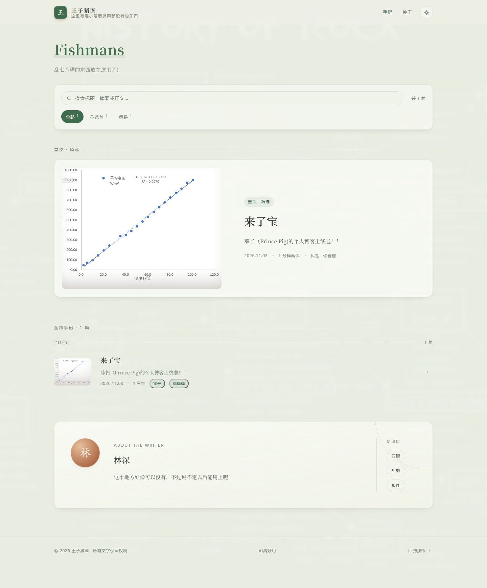
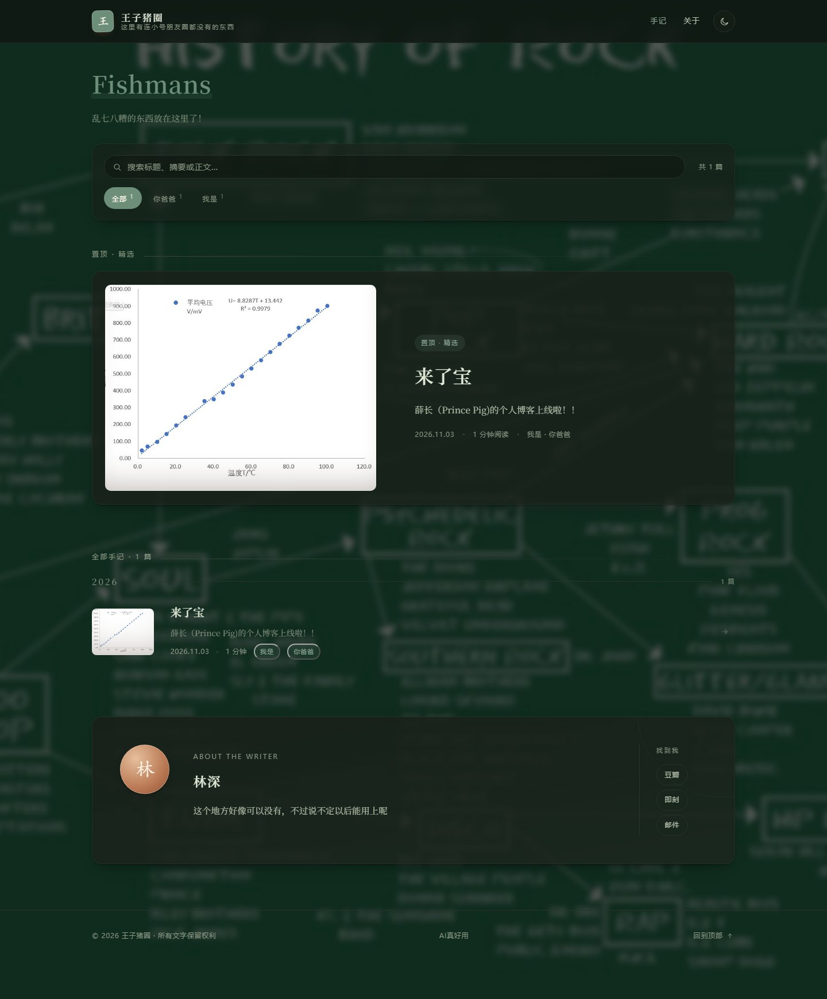
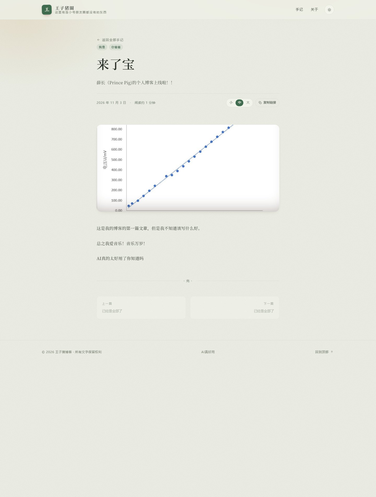
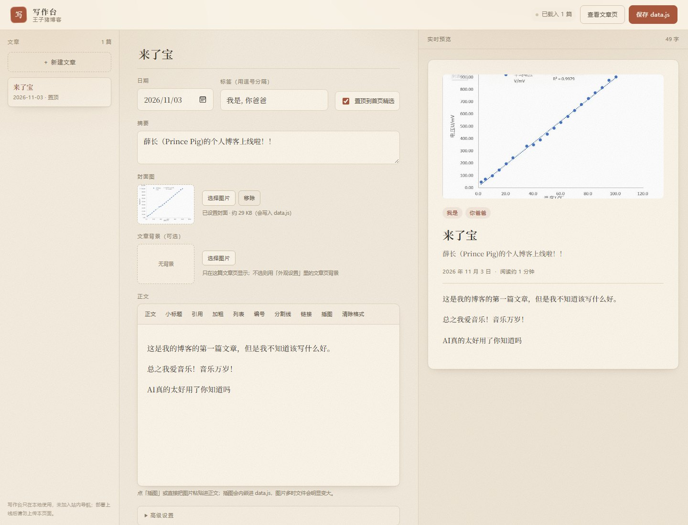
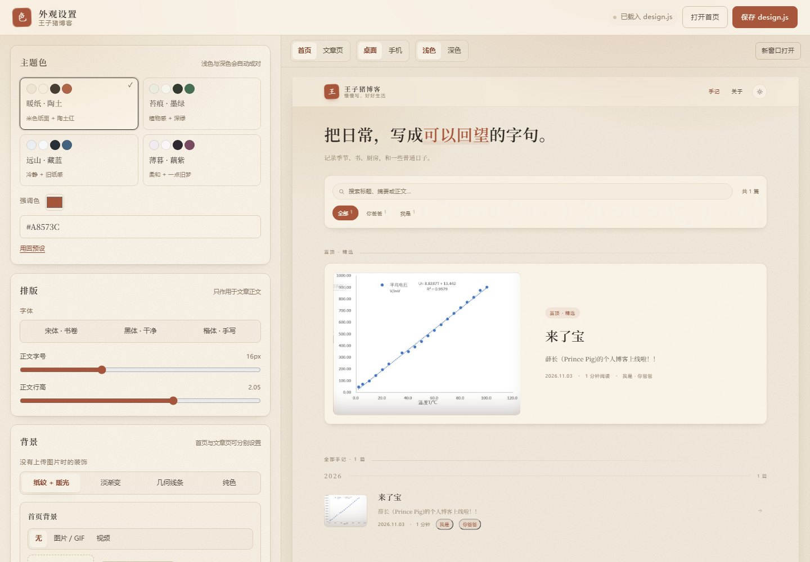

# 王子猪博客

一个纯静态的个人博客：暖色纸感、手记气质、陶土红强调色。没有构建步骤、没有依赖，双击 `index.html` 就能开始读。

## 预览

| 浅色 | 深色 |
| --- | --- |
|  |  |



## 快速开始

直接双击 `index.html` 即可。若想更接近线上环境（比如测试复制链接），可以在这个目录里起一个静态服务：

```bash
# 任选其一
npx serve .
python -m http.server 8000
```

然后访问 `http://localhost:8000`。

> **关于详情页**：文章链接形如 `post.html#a-page-of-days`，必须带上 `#` 后面的文章 id 才能打开对应文章。如果直接双击 `post.html`（没有 id），会看到一个文章目录页，从那里点进去同样可以阅读，不会白屏。

## 目录结构

```
index.html              首页：置顶精选、年份分组、搜索、标签筛选
post.html               文章页：正文、阅读进度、字号、上下篇
admin.html              写作台：写文章、改文章（本地工具）
design.html             外观设置：配色、排版、背景、文字（本地工具）
assets/
  css/style.css         全站样式（含深色主题与响应式）
  css/admin.css         写作台样式
  css/design.css        外观设置样式
  js/data.js            ★ 站点信息与全部文章内容
  js/design.js          ★ 外观配置（由外观设置生成，也可以手改）
  js/common.js          主题、日期、阅读时长、封面生成、页脚等公共逻辑
  js/app.js             首页渲染与筛选逻辑
  js/post.js            文章页渲染逻辑
  js/design-presets.js  4 套配色预设与颜色工具
  js/design-loader.js   把外观配置应用到页面上
  js/design-studio.js   外观设置的交互
  js/admin.js           写作台交互
  js/admin-data.js      生成 data.js 的序列化逻辑
  covers/               放自己上传的封面图
  media/                放背景视频
preview/                效果预览图（部署时可删）
DEPLOY.md               GitHub Pages 发布步骤
README.md
```

## 用写作台写文章（推荐）

双击 `admin.html`，不需要安装任何东西。



1. **新建**：点左上角「＋ 新建文章」，填标题、日期、标签、摘要。
2. **写正文**：直接在编辑器里写；工具栏可以设小标题、引用、列表、加粗、分割线、链接。
3. **插图**：工具栏点「插图」选图片，或者直接把图片**粘贴 / 拖进**正文；图片会自动压缩到 1600px 以内并内嵌，显示在光标位置。
4. **封面**：点「选择图片」，工具会自动压缩到 1200px 宽并转成 base64 存进文章；不选则用自动装饰封面。
5. **文章背景**：在「文章背景（可选）」里选一张图，只在这篇文章页显示；不选则沿用「外观设置」里的文章页背景。
6. **实时预览**：右侧和真实文章页一样排版，随时看效果。
7. **保存**：点右上角「保存 data.js」，第一次会让你选择 `assets/js/data.js`，之后会**直接写回磁盘**；浏览器不支持或拒绝时自动改为下载 `data.js`。
8. **生效**：刷新 `index.html` 即可（如果降级成下载，则把文件覆盖到 `assets/js/data.js`）。

> 正文插图和封面都会内嵌进 `data.js`，图片多时文件会明显变大（每张约 100–300KB），注意别一次塞太多大图。

其他细节：

- **草稿**：所有修改每 0.7 秒自动暂存在浏览器里，关掉页面再打开会提示「已恢复上次未保存的编辑内容」，可以选继续或放弃。
- **置顶**：勾选「置顶到首页精选」会自动取消其他文章的置顶，全站只保留一篇。
- **删除**：点「删除这篇」，保存并覆盖 data.js 后才会真正从网站移除。
- **地址标识**：默认按日期自动生成（如 `post-20261103-1425`），在「高级设置」里可以改成 `riverside-sunday` 这种更好记的，改了就换链接。
- **快捷键**：`Ctrl / Cmd + S` 直接保存。
- **注意**：写作台是本地工具，没有加入站内导航。部署上线时建议不要把 `admin.html` 一起上传。

## 用外观设置改配色、排版和文字

双击 `design.html`。



左侧四块，右侧是**真实首页 / 文章页的实时预览**，可以切换桌面 / 手机、浅色 / 深色。

1. **主题色**：4 套预设（暖纸陶土 / 苔痕墨绿 / 远山藏蓝 / 薄暮藕紫）+ 强调色取色器，浅色与深色会自动成对生成。
2. **排版**：宋体 / 黑体 / 楷体三种字体；正文字号 14–20px；正文行高 1.6–2.3。
3. **背景**：首页与文章页**分别设置**，支持图片、GIF、视频；可调遮罩浓度和模糊；没有上传时使用默认装饰（纸纹 + 暖光 / 淡渐变 / 几何线条 / 纯色）。单篇文章还可以在写作台里单独设置背景，会覆盖这里的「文章页背景」。
4. **文字**：站名、签名、首页大标题、首页简介、关于区介绍、两个导航文字、页脚小字。大标题里用 `{ }` 包住想变色的词，例如 `把日常，写成{可以回望}的字句。`
5. **找到我**：编辑「关于」区右侧的链接文字和地址，可增删，最多 8 项。地址不写 `https://` 会自动补全；某一行删掉就不再显示；全部删空则关于区不显示链接。没在这里改过时，沿用 `data.js` 里 `site.socials` 的配置。

### 保存

- 第一次点「保存 design.js」，浏览器会让你选 `assets/js/design.js` 这个文件；
- Edge / Chrome 支持**直接写回磁盘**，保存后刷新首页即可看到；
- 如果浏览器不允许，会自动降级为下载 `design.js`，你把它覆盖到 `assets/js/` 即可；
- 所有修改每 0.8 秒自动暂存在浏览器里，关掉页面再打开会提示恢复；「放弃修改」可以回到磁盘上的版本。

### 背景图片与视频

- **图片**：自动压缩到 1920px 以内再内嵌，不需要管文件路径；
- **GIF**：保留动画，直接内嵌（超过 4.5MB 会提示）；
- **视频**：不会内嵌，只记录路径（如 `assets/media/bg.mp4`），需要把视频文件复制到 `assets/media/` 目录；建议 mp4、5MB 以内、10–30 秒循环。
- 内嵌图片会让 `design.js` 变大（每张约 100–300KB），介意的话可以改用纯色或渐变背景。

> 外观设置也是本地工具，部署上线时可以不传 `design.html`。
> `assets/js/design.js` 可以手动编辑；删掉它就会回到默认外观。

## 修改站点信息

打开 `assets/js/data.js`，最上方的 `site` 对象：

```js
site: {
  name: "薛长",                    // 署名，出现在「关于」与浏览器标题
  title: "王子猪博客",              // 站名，出现在页头
  tagline: "慢慢写，好好生活",       // 一句话签名
  heroIntro: "记录季节、书、厨房，和一些普通日子。",  // 首页大标题下的一句简介
  intro: "……",                     // 「关于」区的自我介绍
  since: "2023 年秋",              // 首页眉标的起始时间
  avatar: "",                      // 可选：头像图片路径，如 "assets/covers/me.jpg"
  email: "hello@linshen.example",
  socials: [                       // 关于区右侧的联系方式
    { label: "豆瓣", href: "https://…" },
    { label: "邮件", href: "mailto:…" }
  ]
}
```

> 想换成自己的头像：把图片放到 `assets/covers/`，然后在 `site.avatar` 填路径；留空则显示印章式的「林」字圆形头像。

## 手动编辑文章（可选）

不想开写作台、或者想直接改源码时，在 `posts` 数组**最前面**插入一个对象（首页会自动按年份分组，不必手动排序）：

```js
{
  id: "my-new-post",            // 唯一标识，会成为 post.html#my-new-post
  title: "文章标题",
  date: "2025-03-08",           // YYYY-MM-DD
  tags: ["生活", "阅读"],        // 首页筛选条会自动汇总
  featured: false,               // true 的那一篇进入「置顶 · 精选」
  cover: "",                     // 封面图路径，留空用装饰封面
  bg: "",                        // 这篇文章自己的背景图（写作台生成，留空用外观设置里的文章页背景）
  excerpt: "一两句话的摘要，显示在列表和文章页标题下方。",
  content: `
    <p>正文第一段。</p>
    <h2>小标题</h2>
    <p>正文支持 h2 / h3 / p / blockquote / ul / ol / img / strong / a / code / pre / hr。</p>
    <blockquote>一句想被单独记住的话。</blockquote>
  `
}
```

细节：

- `content` 直接写 HTML，缩进不影响显示。
- 阅读时长按每 380 字约 1 分钟自动估算。
- 文章页顶部的阅读进度条、字号切换、复制链接会自动生效。

## 使用封面图

两种方式，任选：

1. **写作台里直接上传**：点「选择图片」，工具会压缩到 1200px 宽并转成 base64 写进文章，不需要管文件路径；代价是 `data.js` 会变大（每张约 100–300KB）。
2. **手动放图片 + 填路径**：把图片放进 `assets/covers/`，例如 `assets/covers/autumn.jpg`，然后在文章的 `cover` 字段填 `cover: "assets/covers/autumn.jpg"`。推荐 1200×900（4:3）、400KB 以内。

没有填 `cover` 的文章会自动生成 CSS 渐变 + 内联 SVG 线稿封面（共 6 种图案，按下标轮换），不依赖任何图片文件，断网也正常显示。上传的封面会以 4:3 的比例裁剪显示。

## 已实现的功能

| 功能 | 说明 |
| --- | --- |
| 文章列表 + 详情页 | 两页式结构，`post.html#文章id` 可直接分享；旧版 `?id=` 链接同样兼容 |
| 置顶精选 | `featured: true` 的文章单独突出展示 |
| 年份分组 | 列表自动按年份归档，显示每年篇数 |
| 标签筛选 | 筛选条自动汇总标签与数量，支持 `index.html?tag=生活` 直达 |
| 站内搜索 | 标题、摘要、正文、标签实时匹配，命中词高亮，支持 `?q=关键词` |
| 深色模式 | 页头按钮切换，记住偏好；深色模式下封面自动压暗 |
| 阅读进度条 | 文章页顶部细线，随滚动推进 |
| 字号调节 | 小 / 中 / 大，记住偏好 |
| 复制链接 | 一键复制当前文章地址，失败时自动降级 |
| 上一篇 / 下一篇 | 文章底部按时间相邻跳转 |
| 响应式 | 桌面、平板、手机三档布局，支持减少动效偏好 |
| 打印样式 | 打印文章时自动隐藏导航与工具栏 |
| 写作台 | 双击 `admin.html`：新建 / 编辑 / 删除 / 置顶、正文插图、实时预览、草稿暂存、封面压缩、一键生成 `data.js` |
| 外观设置 | 双击 `design.html`：预设主题与强调色、字体 / 字号 / 行高、图片 / GIF / 视频背景、文案覆盖、「找到我」链接、真实页面实时预览 |
| 每篇独立背景 | 写作台里可给单篇文章设置背景图，覆盖全站的文章页背景；有背景时阅读区会自动垫一层纸面保证可读性 |
| 自定义背景 | 首页与文章页可分别设置；无图时用纸纹、渐变、几何线条或纯色装饰 |

## 换配色

最方便的方式是用 `design.html`：选预设、拖强调色，保存后全站生效。

也可以手动改：

- `assets/js/design.js` 里的 `preset`（terracotta / forest / navy / mauve）和 `accent`；
- 或者改 `assets/css/style.css` 顶部的 `:root` 与 `[data-theme="dark"]` 变量，最常改的是：

```css
--accent: #a8573c;       /* 强调色：陶土红 */
--bg: #f3ebdd;           /* 页面底色 */
--paper: #fbf5ea;        /* 卡片 / 纸张色 */
--ink: #2f2a24;          /* 正文颜色 */
```

换一套色只需改这几行，其余元素会自动跟随。注意：`design.js` 里的配色会覆盖 `style.css` 里的同名变量。

## 部署

这是纯静态站点，把 `index.html`、`post.html`、`assets/` 上传到任意静态托管即可：

- **GitHub Pages**：完整步骤见 [DEPLOY.md](DEPLOY.md)（建仓库 → 上传 → Settings → Pages）
- **Netlify / Vercel**：直接拖拽文件夹，无需构建命令
- **任意虚拟主机**：上传到网站根目录

> 注意：`admin.html`（写作台）和 `design.html`（外观设置）是本地工具，部署时不必上传；`career-plan/` 等无关文件夹也不要传。

> 注意：文章内容集中在 `data.js` 中，用 `file://` 打开完全正常；但如果日后改成 `fetch` 读取外部 JSON，就需要通过 HTTP 服务访问，否则会被浏览器的本地文件策略拦截。

## 一点说明

示例中的「薛长」、简介、邮箱与社交链接都是占位内容，请替换为自己的信息后再发布。六篇示例随笔可按需删除或改写。

---

用纯 HTML / CSS / JS 写成，没有框架、没有追踪脚本。慢慢写，好好生活。
